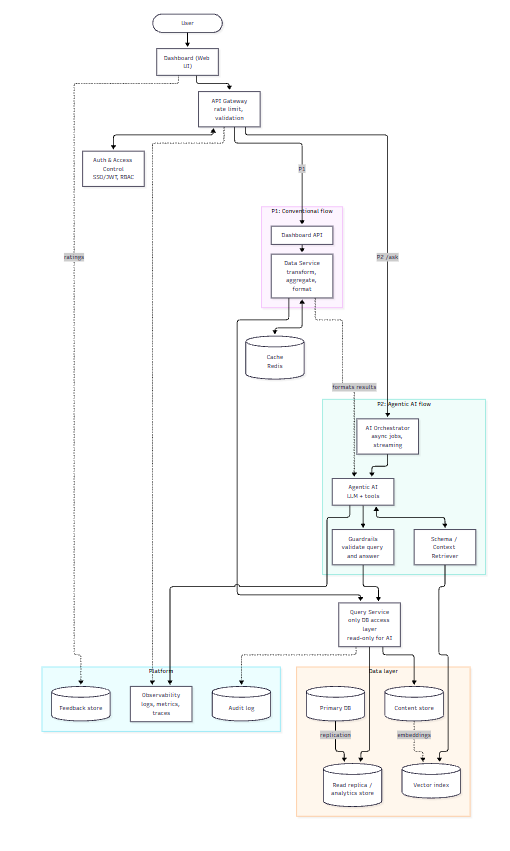
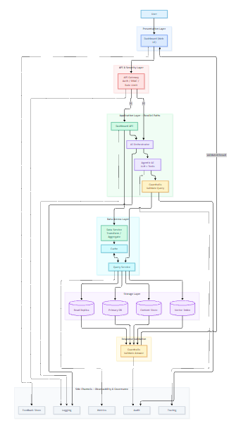
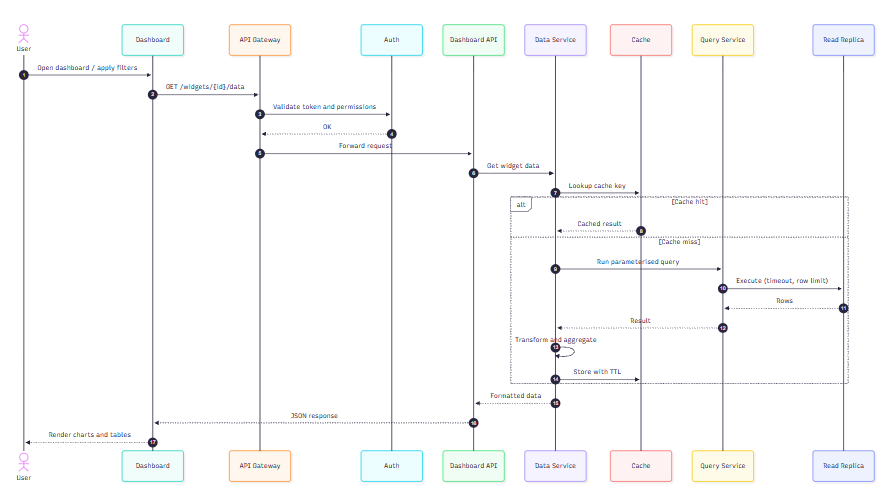
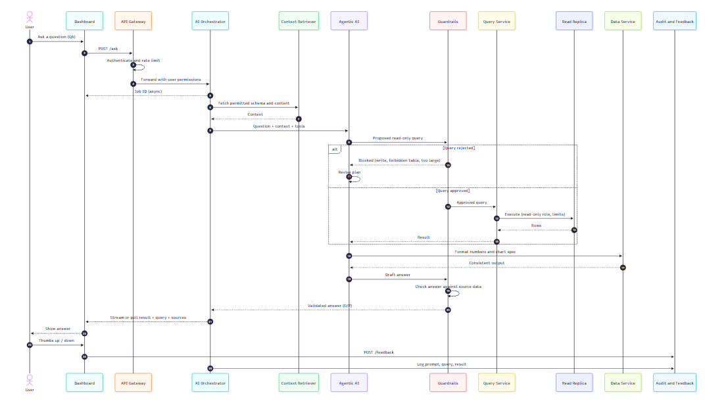

### General Arcitecture :



-------------or---------------


### P1( General ) workflow :



### P2 ( Agentic AI ) workflow :



## Running with the backend

1. Start the backend (`vaakDB-backend`, see its README) on `http://localhost:8000`.
   Its `.env` must allow this origin: `CLIENT_URL=http://localhost:3000` (or `CORS_ORIGINS`).
2. Point the frontend at it (read at **build** time, so restart `npm run dev` after changing it):

   ```bash
   cp .env.example .env.local      # NEXT_PUBLIC_API_URL=http://localhost:8000/api/v1
   npm install
   npm run dev                     # http://localhost:3000
   ```
3. Register on the login page (or `python scripts/create_user.py you@example.com` in the backend).
   Every account gets its own private workspace with full access to its own data and none to
   anyone else's.

| Frontend | Backend endpoint |
|---|---|
| Login / register (`app/login`) | `POST /auth/login`, `POST /auth/register`, `GET /auth/me` |
| Chat (`hooks/use-vaakdb-chat.ts`) | `POST /chat` (Server-Sent Events: `status`, then `result` or `error`) |
| Attach file (`components/chat/chat-input.tsx`) | `POST /files/upload` (PDF, CSV, XLSX) |
| Preview → Confirm / Cancel (`components/vaakdb/operation-preview.tsx`) | `POST /operations/{id}/confirm`, `/cancel`, `GET /operations/{id}` |
| Schema sidebar | `GET /schemas`, `/schemas/{s}/tables`, `/schemas/{s}/tables/{t}` |
| My workspace page, Create table | `GET /schemas`, `POST /operations`, `GET /connections/status` |

All calls live in `lib/vaakdb-api.ts`; response types mirror the backend in `lib/types.ts`.
Chats are cached in the browser per user; the JWT is stored in localStorage and a 401 sends you
back to the login page.
